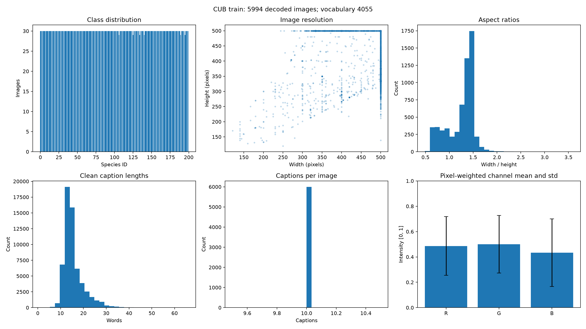
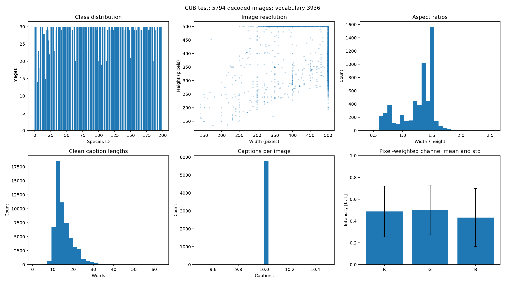

# CUB data findings

The official Hugging Face splits were audited in full on 2026-11-03: 5,994 training images and 5,794 test images, with 200 species in each. Every image decoded successfully. There were no exact decoded-pixel overlaps between training and test.

| Finding | Training | Test |
| --- | ---: | ---: |
| Images before cleaning | 5,994 | 5,794 |
| Minimum/maximum images per class | 29 / 30 | 11 / 30 |
| Maximum/minimum class count ratio | 1.0345 | 2.7273 |
| Median image width / height | 500 / 375 | 500 / 375 |
| Width range (pixels) | 121–500 | 140–500 |
| Height range (pixels) | 120–500 | 134–500 |
| Aspect ratio range | 0.488–3.597 | 0.375–2.564 |
| Clean captions per image | 10 | 10 |
| Mean words per caption | 15.309 | 15.289 |
| Median words per caption | 14 | 14 |
| Caption length range (words) | 1–66 | 1–64 |
| Clean vocabulary size per split | 4,055 | 3,936 |
| Images with repeated normalized captions | 585 | 604 |
| Images with digits in descriptions | 65 | 58 |
| Images with control/replacement characters | 27 | 29 |
| Images with captions under three words | 1 | 1 |

The training set is almost balanced, so ordinary cross-entropy is appropriate without class reweighting or oversampling. Test support varies more, which makes macro metrics useful alongside accuracy and weighted metrics. Test class proportions are never changed.

One training image is an exact decoded-pixel duplicate: row 1731 repeats row 1712 with the same label. The cleaning manifest excludes the later row, leaving 5,993 training-source images. The seeded 15% stratified validation holdout therefore contains 899 images and model training contains 5,094. There are no conflicting duplicate labels or unreadable test records. No test images are excluded.

The pixel-weighted RGB means are `[0.48619, 0.50047, 0.43337]` for training and `[0.48681, 0.50056, 0.43154]` for test. Corresponding standard deviations are `[0.23210, 0.22770, 0.26651]` and `[0.23264, 0.22781, 0.26667]`. These are descriptive measurements; both encoders use the same fixed ImageNet normalization to match the transfer initialization.

Rare training tokens include likely typos such as `aalso`, `aare`, `abdobmen`, and `againsst`, as well as valid uncommon vocabulary. They are review candidates rather than automatic replacements. Digit-bearing tokens such as `2white` and control-character noise are flagged. The normalizer removes punctuation/control separators, standardizes Unicode and whitespace, and keeps the resulting caption order. Duplicate captions remain documented rather than silently changing the expected ten descriptions. Captions do not affect classification labels or training selection.

Variation in image aspect ratio and bird scale supports moderate resized cropping and horizontal flips. Small hue/saturation changes avoid erasing species color cues. No vertical flips or severe geometric distortions are used. Center crops provide a deterministic shared evaluation protocol, although they can omit birds near an image edge; this is a limitation to inspect with Grad-CAM.

Visual inspection also found photographer credits/watermarks and occasional species names embedded in photographs, including the sampled Nashville Warbler image. These are potential shortcuts. The audit does not perform text detection, and the official test images are not edited to remove them. Grad-CAM should be checked for attention on text as well as background.

Reproduce the full measurements and figures with `python -m src.cli eda --config configs/eda.yaml`. Detailed per-record evidence remains under `outputs/eda/`, including raw-row indices, anomaly flags, pixel hashes and cleaning decisions. Preprocessing steps and exact run commands are documented in the repository README.
